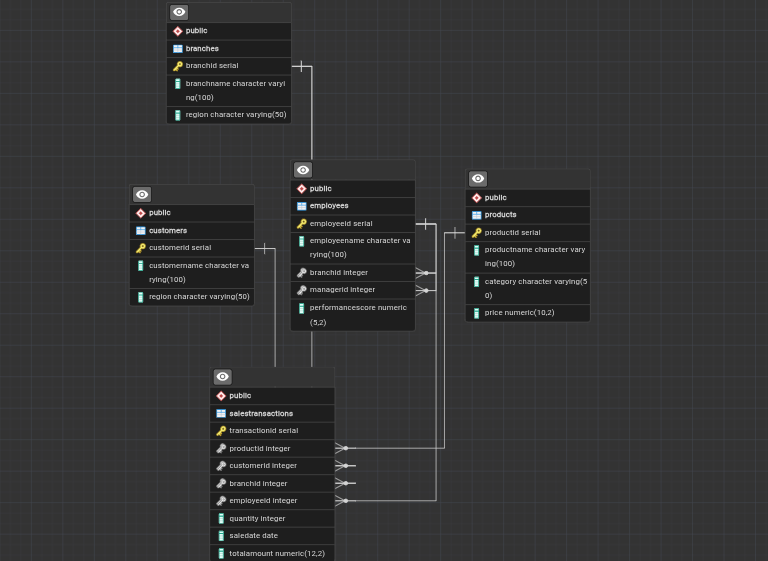

# 1.Retail-Sales-Branch-Analytics-Project-

# 2.Group Members
| Member Name | Roll Number |
| :-- | :-- | 
| Mussab Altoom | 202510073 |
| Adil Salah | 202510277 |
| Osman Musa | 202511534 |
| Anas Yaseir | 202512831 |

# 3.Business Background
A major retail company operates multiple branches across different regions, employing staff and serving diverse customers with various product categories (Electronics, Accessories, Furniture). Management requires deep analytical insights to monitor regional performance and customer trends.
# 4.Problem statement
The organization struggles to track cumulative sales, compare sequential monthly performance, identify top-performing products per category, and accurately segment customer spending behavior using advanced SQL queries.
# 5.project objectives.
Build a relational database for a multi-branch retail company.
- Analyze cumulative and month-over-month sales using window functions.
- Analyze customer spending using JOINs and ranking.
# 6.Database schema and table descriptions.
| branches | Branch names and regions |
| products | Products and categories |
| customers | Customer details |
| sales | Sales transactions linked to branch, product, and customer |
| employees | Employee details and management structure |

# 7. ER Diagram

The database schema is designed to track retail operations, consisting of 5 related tables: `branches`, `employees`, `customers`, `products`, and `sales`. 
The Entity Relationship Diagram (ERD) visually represents these relationships, including all Primary Keys and Foreign Keys used to maintain referential integrity.


*(The full-resolution image is located in the `documentation/` folder).*

---

# 8. JOIN Implementations

**1. INNER JOIN**
``` sql
-- Retrieve records that have matching values in both tables
SELECT s.sale_id, s.sale_date, p.product_name, s.quantity, s.total_amount
FROM sales s
INNER JOIN products p ON s.product_id = p.product_id;
Business Interpretation: This query retrieves all sales transactions alongside the specific names of the products sold. It helps the business understand exactly which items are moving through the checkout process, excluding any products that have never been sold.
```
* 2. LEFT JOIN
``` sql
-- Identify records in the left table that have no matching records in the right table
SELECT c.customer_id, c.first_name, c.last_name, s.sale_id
FROM customers c
LEFT JOIN sales s ON c.customer_id = s.customer_id
WHERE s.sale_id IS NULL;
Business Interpretation: This query identifies registered customers who have not made any purchases yet. The marketing team can use this specific list to target these inactive customers with personalized first-time discount offers.
```
* 3. RIGHT JOIN
``` sql
-- Identify records in the right table that have no matching records in the left table
SELECT s.sale_id, s.total_amount, e.first_name AS employee_name
FROM sales s
RIGHT JOIN employees e ON s.employee_id = e.employee_id
WHERE s.sale_id IS NULL;
Business Interpretation: By using a right join, we isolate employees who have not processed any sales transactions. This allows management to quickly identify staff members who might be in non-sales roles, or new hires who require additional sales system training.
```
* 4. FULL OUTER JOIN
``` sql
-- Display matching and unmatched records from both tables
SELECT b.branch_name, s.sale_id, s.total_amount
FROM branches b
FULL OUTER JOIN sales s ON b.branch_id = s.branch_id;
Business Interpretation: This query returns all branches and all sales records, combining them where there is a match while keeping unmatched rows. It is essential for auditing purposes to ensure every recorded sale is correctly allocated, and it highlights any newly opened branches that lack sales data.
```
* 5. SELF JOIN
``` sql
-- Compare records within the same table
SELECT e1.first_name AS employee_name, e2.first_name AS manager_name
FROM employees e1
INNER JOIN employees e2 ON e1.manager_id = e2.employee_id;
Business Interpretation: This query pairs retail employees directly with their respective managers within the same employee table. It provides a clear view of the organizational reporting structure inside the branches. Store directors can use this to ensure an optimal staff-to-manager ratio.
```
# 9. Window Function Implementations
```
```
* A. Ranking Functions
``` sql
-- Rank products according to sales performance
SELECT p.product_name, SUM(s.total_amount) as total_revenue,
RANK() OVER (ORDER BY SUM(s.total_amount) DESC) as revenue_rank,
DENSE_RANK() OVER (ORDER BY SUM(s.total_amount) DESC) as dense_revenue_rank
FROM products p
JOIN sales s ON p.product_id = s.product_id
GROUP BY p.product_name;
Business Interpretation: We used the RANK() and DENSE_RANK() functions to order our products based on their total generated revenue. This allows the purchasing department to definitively identify the top-performing products. Consequently, inventory managers can ensure these high-rank items are always in stock.
```
* B. Aggregate Window Functions (Demonstrating ROWS and RANGE)
``` sql
-- Calculate running sales totals using ROWS
SELECT sale_date, branch_id, total_amount,
SUM(total_amount) OVER (
    PARTITION BY branch_id 
    ORDER BY sale_date 
    ROWS BETWEEN UNBOUNDED PRECEDING AND CURRENT ROW
) as branch_running_total
FROM sales;
```
* Calculate cumulative revenue within a specific date range using RANGE
``` sql
SELECT sale_date, total_amount,
SUM(total_amount) OVER (
    ORDER BY sale_date 
    RANGE BETWEEN INTERVAL '7' DAY PRECEDING AND CURRENT ROW
) as weekly_rolling_sum
FROM sales;
Business Interpretation: The first query calculates the cumulative running total of sales for each branch over time using the ROWS frame, helping managers track progress toward monthly financial targets. The second query uses the RANGE frame to calculate a rolling 7-day sales sum. This helps the financial team analyze short-term cash flow trends regardless of the exact number of daily transactions.
```
* C. Navigation Functions
``` sql
-- Compare current monthly sales with previous monthly sales
SELECT DATE_TRUNC('month', sale_date) as sale_month, SUM(total_amount) as current_sales,
LAG(SUM(total_amount), 1) OVER (ORDER BY DATE_TRUNC('month', sale_date)) as previous_month_sales,
LEAD(SUM(total_amount), 1) OVER (ORDER BY DATE_TRUNC('month', sale_date)) as next_month_sales
FROM sales
GROUP BY DATE_TRUNC('month', sale_date);
Business Interpretation: The LAG() function compares the total revenue of the current month directly with the revenue of the previous month. This month-over-month comparison is critical for identifying seasonal retail trends. It immediately highlights any unexpected decreases in revenue that require immediate investigation.
```
* D. Distribution Functions
``` sql
-- Divide customers into four spending groups
SELECT customer_id, SUM(total_amount) as total_spent,
NTILE(4) OVER (ORDER BY SUM(total_amount) DESC) as spending_quartile,
CUME_DIST() OVER (ORDER BY SUM(total_amount)) as cumulative_distribution
FROM sales
GROUP BY customer_id;
Business Interpretation: Using NTILE(4), we divided our customer base into four distinct groups (quartiles) based on their total spending, while CUME_DIST() shows their relative standing. Quartile 1 represents our most valuable VIP customers, whereas Quartile 4 represents occasional buyers. This precise segmentation is utilized to deploy targeted loyalty programs and customized marketing campaigns.
``` 
# 10. Key Analytical Findings
Based on the execution of our SQL queries, we derived the following business insights:

1. Descriptive Analysis - What happened?
The execution of our RANK() queries revealed that a small subset of our electronics products generates the majority of branch revenue. Furthermore, the NTILE(4) distribution function showed that our top 25% of customers account for a disproportionately large share of total sales, while the LAG() function highlighted a consistent dip in overall sales during the mid-year months.

2. Diagnostic Analysis - Why did it happen?
The mid-year sales dip, identified via the navigation functions, aligns with historical inventory shortages of our top-ranked products during that period. Additionally, our LEFT JOIN analysis revealed a significant number of registered customers who never made a purchase, indicating a potential friction point in the customer onboarding or initial promotional strategy.

3. Prescriptive Analysis - What should be done next?
Management should use the weekly_rolling_sum data to forecast demand and proactively reallocate inventory for top-performing products before the mid-year dip. Furthermore, the marketing department should launch an aggressive, automated email campaign offering first-purchase discounts specifically targeting the inactive customers identified in the LEFT JOIN query.

# 11. Instructions for Executing the SQL Scripts
To successfully review the database and replicate our analysis, please execute the scripts in the following order:

Database Setup:

Open the database/ folder.

Run 01_create_tables.sql to generate the schema.

Run 03_constraints.sql to establish the Primary and Foreign Keys.

Data Insertion:

Run 02_insert_data.sql to populate the tables with our sample retail data.

Executing JOINs:

Navigate to the queries/ folder.

Run scripts 01_inner_join.sql through 05_self_join.sql sequentially to review the relational data extraction.

Executing Window Functions:

Run scripts 06_ranking_functions.sql through 09_distribution_functions.sql to view the advanced analytical results.

Ensure your SQL environment supports standard ANSI SQL window functions before execution.
